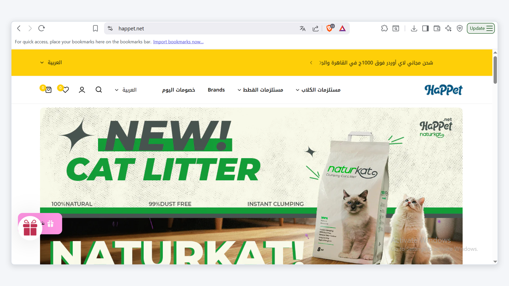
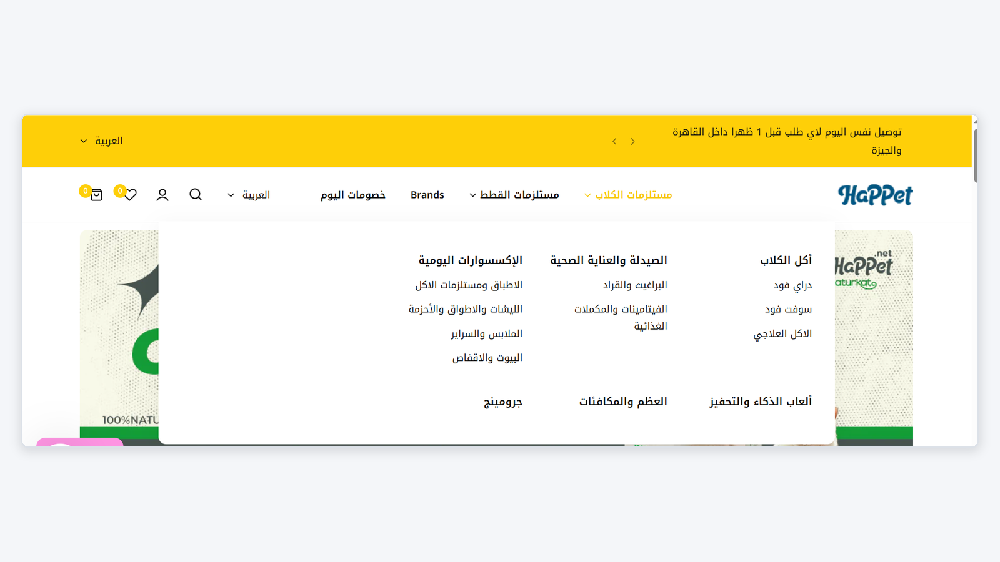
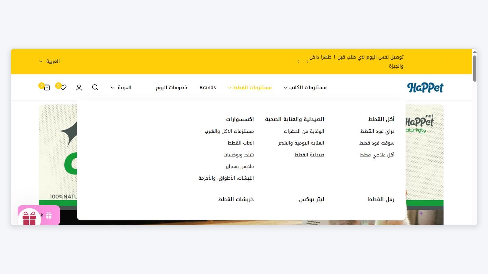
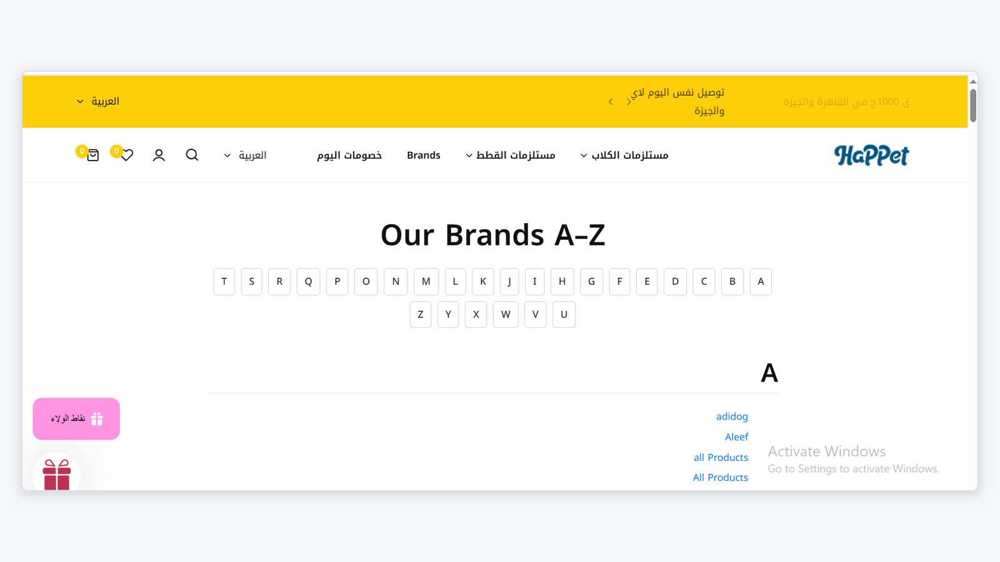
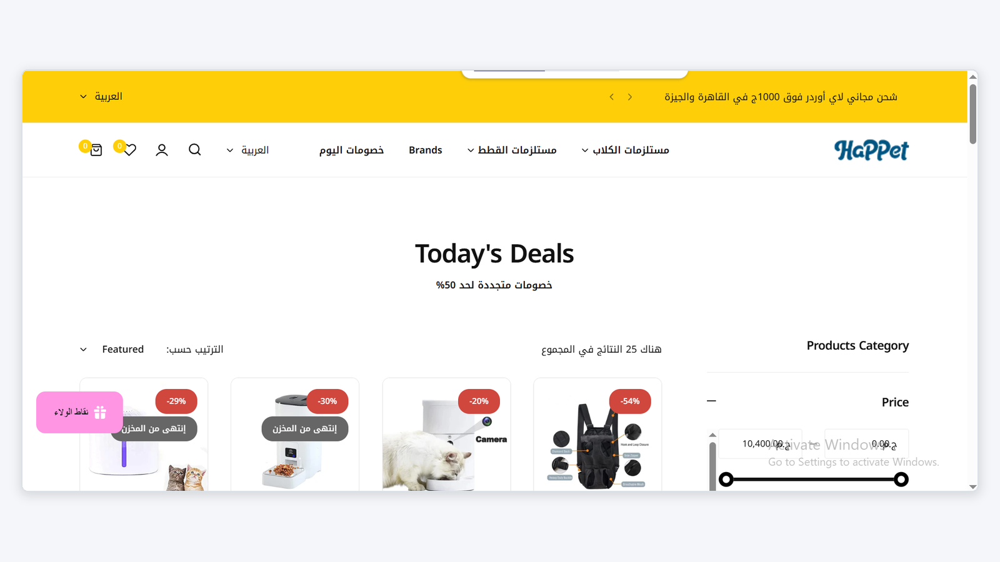
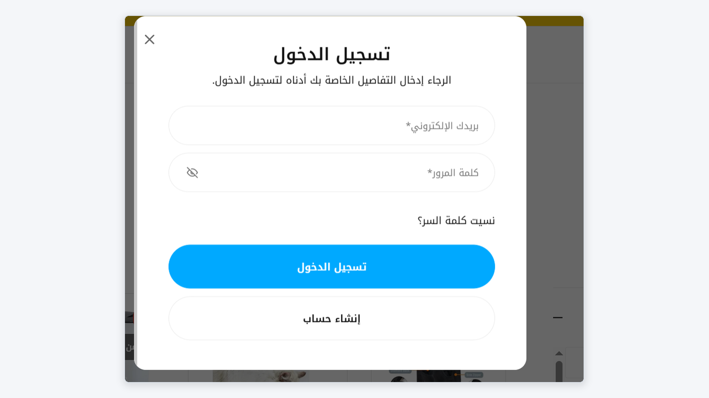

# 🐾 Happet Pet Store Testing Suite

**Manual Testing | E-commerce Website | TestRail | Bug Reporting**

## 📌 Project Overview

This project focuses on manual testing of the [Happet Pet Store](https://happet.net/) e-commerce website to evaluate its functionality, usability, navigation, and overall user experience.

**Project Status:** Planned / In Progress

## 🎯 Project Objectives

- Verify key website functionalities.
- Evaluate navigation and user experience.
- Design and organize test scenarios and test cases.
- Document test execution results.
- Report and track defects with clear reproduction steps.
- Practice a structured manual testing workflow.

## 🧪 Testing Scope

| Area | Testing Focus |
|---|---|
| Homepage | Layout, banners, and navigation |
| Product Navigation | Dog and cat product categories |
| Brands | Brands listing and navigation |
| Today's Deals | Product listings and displayed information |
| Login | Login form and validation |
| Usability | Layout, consistency, and user experience |

## 🖼️ Website Screenshots

### 1. Homepage



### 2. Dog Supplies Navigation



### 3. Cat Supplies Navigation



### 4. Brands Listing Page



### 5. Today's Deals



### 6. Login Modal



## 📋 Planned Deliverables

- Test Plan
- Test Scenarios
- Test Cases
- Test Execution Report
- Bug Reports
- Test Summary Report

## 🛠️ Tools & Technologies

- **Test Management:** TestRail
- **Testing Type:** Manual Testing
- **Documentation:** Markdown / GitHub
- **Defect Reporting:** Structured Bug Reports
- **Version Control:** Git & GitHub

## 📁 Project Structure

```text
happet-pet-store-manual-testing/
│
├── Images/
│   ├── 01-homepage-cat-litter-banner.png
│   ├── 02-dog-supplies-navigation.png
│   ├── 03-cat-supplies-navigation.png
│   ├── 04-brands-listing-page.png
│   ├── 05-todays-deals-product-list.png
│   └── 06-login-modal.png
│
└── README.md
```

## 📈 Project Progress

- [x] Repository created
- [x] Website screenshots collected
- [x] Project documentation initiated
- [ ] Test scenarios designed
- [ ] Test cases documented
- [ ] Test execution completed
- [ ] Defects documented and verified
- [ ] Final test summary prepared

## ⚠️ Disclaimer

This is an independent portfolio project for learning and demonstrating manual software testing skills. The testing activities, execution results, and defects will be documented based on actual verification. No unverified test results or defects are claimed.

## 👨‍💻 Author

**Muhammed Raafat**

- GitHub: [muhammed-elgarf](https://github.com/muhammed-elgarf)

---

*Software Testing Portfolio Project*
